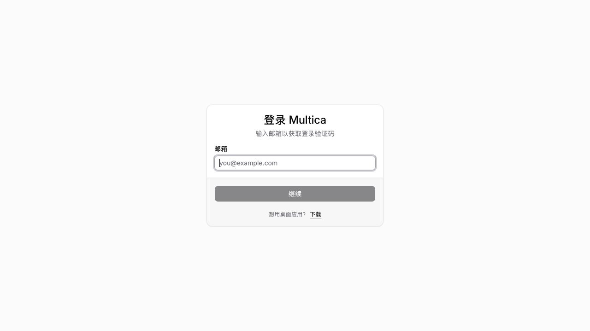
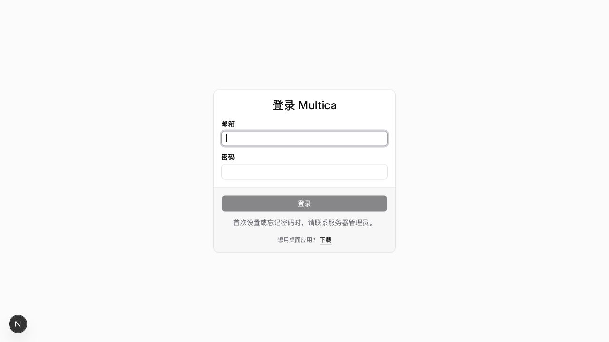
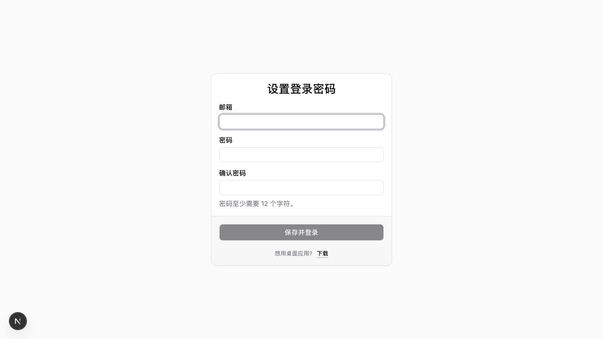

# Self-hosted password login

Set `MULTICA_PASSWORD_LOGIN=true` and configure `REDIS_URL`, then deploy the backend and web images built from this checkout. Password endpoints fail closed with HTTP 503 if Redis is not configured or becomes unavailable. Existing email-code endpoints return 403 in password mode. The flag defaults to false for unchanged deployments.

Passwords use salted PBKDF2-HMAC-SHA256 (600,000 iterations). The initial password requires at least 12 characters and at most 512 UTF-8 bytes. There is no public password registration or email dependency; only existing accounts can sign in. Existing sessions and user/workspace data are retained. The shared web/desktop login page retains CLI authorization. Already-installed desktop clients need to use browser authorization or an updated build to show the new form; the mobile login UI is not changed.

## Set the first password

1. Ensure the intended account already exists. For a new installation, bootstrap it with the existing email-code flow before enabling password mode. Self-hosted installations without email delivery print the code in the backend log.
2. Generate a setup capability locally:

   ```sh
   python3 scripts/create-password-setup.py --email owner@example.com --url https://multica.example.com --env-file /path/to/deployment/.env
   ```

3. Recreate the backend with that environment. Open the link in the owner-only `.password-setup-link.txt` beside the environment file. The account owner enters their email and chooses their password in the browser.
4. Delete the link file and remove the three `MULTICA_PASSWORD_SETUP_*` values after successful setup, then recreate the backend again.

The link expires after one hour, only works for the configured existing email, and cannot replace a password that is already set. Its token is sent in the POST body, not in URL query parameters. Do not log request bodies or share the link. If it expires before use, generate another one. Keep the web build, backend, and migrations together when enabling this feature.

## Recovery and rollback

There is no self-service password reset or password change in this initial implementation. Contact the server administrator if the password is lost. Do not enable unrestricted signup or publish a shared password as a workaround.

To return to the previous login mode, set `MULTICA_PASSWORD_LOGIN=false` and recreate the backend. Password hashes remain stored for a later re-enable; reverting the flag does not delete accounts or projects. The two new migrations can be rolled back independently of existing account data, but rolling back the table removes stored password hashes.

## Screenshots

Before (email code):



After (password mode, isolated local test environment):



First password setup (isolated local test environment):


